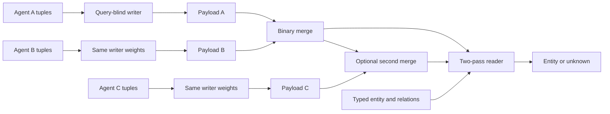

# Architecture and implementation review

## What enters the system

- **Generator and labels.** Each world is a table of independent functional
  relations. Evaluator-only lookup computes the final answer and the first
  hop. The two-hop ambiguity check enumerates consistent missing-edge
  completions under independent relation mappings. The follow-up keeps
  world IDs, input facts, paths, labels, and generation counts in evaluation
  evidence. Neural inference receives tensors through the writer/merge/read
  boundary. Raw union scoring is explicitly labeled.
- **Writer.** `LearnedMemory.event_features` embeds subject, relation,
  object and revision. Its key uses subject, relation and revision. Its
  nonnegative value also sees the object. Softmax routes each fact over
  learned slots. Sum or max pools across events, yielding a fixed-size
  query-blind float32 tensor. An event influenced by sum can still be
  hard to decode. Under max, a stronger collection of events can conceal
  a fact completely at every coordinate.
- **Merge.** The residual computes `A + B + gate × correction` using
  symmetric features `[A+B, |A−B|, A×B]`. It has an empty-state identity.
  DeepSets uses `rho(phi(A) + phi(B))`. SUM and MEAN combine sum states.
  MAXSET combines separately max-pooled states. On finite nonnegative
  event features, coordinatewise max composes exactly as event-set union,
  including the zero sentinel for empty histories. That property concerns
  the memory operation and can coexist with information loss.
- **Reader.** Layer normalization and attention read each state using the
  query's subject and relation. The second hop reads using an embedding
  formed from the first-hop predicted distribution. A weak first read
  can affect both hops. A weak union replay result leaves writer
  representation, reader and optimization as live explanations.
- **Storage.** The frozen pilot retains exactly 1,152 payload bytes per
  state. Capacity fits retain 32, 96 or 192 bytes. These budgets exclude
  shared weights, two input tensors and transient workspace. The packed
  table stores only a fixed-size byte string per world. Its lookup
  schema is global. It supports conflict-free revision-zero events and
  shares the same capacity budget. It has access to structured fact IDs.

## Repository and provenance

| Scope | Reviewed assets and outcome |
|---|---|
| Frozen pilot | `src/merge_memory.py`, `src/theory.py`, original test suite, config, protocol and deviation log. Training matches the declared two-stage design and uses final steps. The saved primary contrast reconstructed from 396,000 rows and all 173 frozen-pilot audit assertions passed. |
| Paper and supporting material | `paper/manuscript.tex`, build/report scripts, claim ledger, literature and protocol audits, plot and result manifests. Paper and archived figures agree on the negative primary result and the limits of the one-row associativity probe. The manuscript checksum matches the saved compile status. No new paper build was needed for the code and report review. |
| Existing v0.2 branch | Audited the prior writer-only code, protocol, deviations, saved corpora and scores at `dd03542`. Its archive checks passed on 486,000 prediction rows. The branch also contains five rounds of proposals. These are research agendas. The follow-up branch is based on `main`. See the [existing branch](https://github.com/richardsh3n/mergeable-neural-memory/tree/dd0354217812841d4535576eea3d8071cd8bf3d6). |
| Follow-up | `experiments/followup/` provides the config, generator, continuation and three-party diagnostics, capacity runner and packed baseline. `scripts/audit_followup.py` reconstructs scores from archived predictions and validates hashes. |

## Confirmed defects and treatment

| Evidence | Effect | Treatment in this PR |
|---|---|---|
| The old associativity probe rolled one query row in four-query world blocks. | Three out of four third inputs repeated A. It could not test three independent histories. | The follow-up samples three real histories, checks every party's contribution across the query block, and scores all 12 ordered trees plus reference and redelivery. |
| The lower-level v0.1 training entry point creates the output with `exist_ok=True`, then writes evidence files directly. The historical wrapper checks for an empty directory before training, which leaves a race. | An existing result can be overwritten by direct invocation, and two invocations can select the same empty directory. | `scripts/reproduce_pilot.py` and the follow-up runner use exclusive directory creation and reject archived-result destinations, including paths that traverse a symlink into that tree. The historical code remains available for exact archival verification. |
| v0.1 reports float32 byte count from a constant and does not validate returned tensor dtype. With a changed PyTorch default dtype, a constructed model can retain float64. | State-byte claims rely on the process default. | Follow-up fits and checkpoint loads force float32. Evaluation validates the dtype, CPU device, shape, real bytes, and finite values. |
| v0.1 loses generation-rejection counts. v0.2 used mismatched written and executed seeding, and failed on result JSON serialization after inference. | The old acceptance process cannot be reconstructed from saved rows. The v0.2 result has a disclosed protocol deviation. | New samplers count outcomes. Both fitting arms share the same batch in each matched comparison. The implementation hashes inputs before work, writes native JSON values, and writes the artifact manifest only after complete output. |
| v0.2's headline uses a different aggregation from its world-macro fit table. | Its future-arm accuracy appears as both 79.8% and 79.54%; the local arm shows 68.0% and 67.72%. | Cite the preserved world-macro fit table and +11.82 pp contrast. The gate's 79.76% value comes from query-micro aggregation. The earlier gate outcome remains failed. |

The original archive, including paper, historical tests, documentation, code
and both levels of result manifests, can still be verified byte for byte against
the phase-one package manifest. New protocols and results are linked from
[this follow-up index](README.md).
